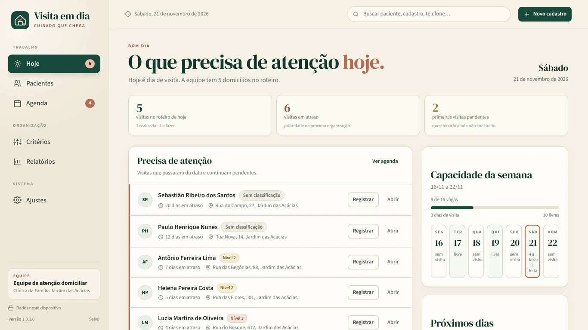

# Visita em dia

Aplicativo para equipes de atenção domiciliar organizarem cadastro, avaliação,
classificação justificada e agenda de visitas. As páginas deste repositório são
a apresentação pública do produto e os documentos legais exigidos pelas lojas e
pelo Google Cloud.

[](https://wavizo-bot.github.io/Visita-em-dia/)

## O que é

O Visita em dia ajuda a equipe a responder três perguntas: quem precisa de
visita, com que frequência e por quê. O aplicativo reúne o cadastro do paciente,
o questionário de avaliação, a classificação sugerida com justificativa e a
agenda — respeitando os dias de visita e a capacidade diária do serviço.

É um apoio operacional. Não é prontuário eletrônico, não substitui o e-SUS ou
os sistemas oficiais e não é um dispositivo médico. A decisão final é sempre da
equipe responsável.

## Recursos principais

- Cadastro com identificação, contato, endereço, equipe, cuidador, condições de
  saúde e dispositivos.
- Busca por nome, cadastro, CNS, CPF, telefone ou rua, com filtros por
  classificação e profissional.
- Avaliação configurável com pontuação por critério, regras de gatilho, nível
  sugerido e justificativa editável.
- Ficha de classificação com respostas, pontuação, histórico e impressão em PDF.
- Agenda com planos por profissional, dias de visita, capacidade diária, datas
  bloqueadas, roteiro do dia e registro de visitas realizadas ou faltas.
- Relatórios com pessoas em acompanhamento, atrasos, visitas realizadas e
  distribuição por classificação; exportação em CSV.
- Funciona offline, sem conta obrigatória e sem servidor do desenvolvedor.

## Privacidade e armazenamento

- Os dados ficam no armazenamento privado do aplicativo, no dispositivo, com
  criptografia em repouso.
- O backup é opcional, criado pelo usuário e cifrado com uma senha própria.
  Pode ser salvo como arquivo ou na pasta de dados privada do aplicativo no
  Google Drive (`drive.appdata`), sem acesso aos demais arquivos da conta.
- Não há anúncios, rastreamento, telemetria, venda de dados ou envio automático
  para servidores do desenvolvedor.
- Cada dispositivo tem sua própria base. Não há sincronização em tempo real
  entre aparelhos; a transferência é feita por backup e restauração.

Leia a [política de privacidade](https://wavizo-bot.github.io/Visita-em-dia/politica-de-privacidade.html)
para os detalhes de tratamento, retenção e direitos do titular.

## Requisitos

- **Windows:** Windows 10 versão 1809 ou superior, 64 bits, com WebView2
  Runtime. A janela do aplicativo tem tamanho mínimo de 900 × 620 px.
- **Android:** Android 7.0 (API 24) ou superior. O layout se adapta de celulares
  a tablets.
- **Armazenamento:** a base fica no armazenamento privado do aplicativo; o
  espaço necessário depende do volume de cadastros, visitas e avaliações.
- **Conta:** nenhuma conta é obrigatória. A conexão com o Google é opcional e
  serve apenas ao backup.

## Versão atual

| Plataforma | Versão | Situação |
| --- | --- | --- |
| Windows (MSIX x64) | 1.0.1.0 | pacote pronto; atualização da loja em preparação |
| Android (AAB) | 1.0.0 | pacote pronto; envio ao Google Play em preparação |

A landing e este README exibem as mesmas versões dos pacotes mais recentes.

## Páginas publicadas

- Início: https://wavizo-bot.github.io/Visita-em-dia/
- Política de privacidade: https://wavizo-bot.github.io/Visita-em-dia/politica-de-privacidade.html
- Termos de serviço: https://wavizo-bot.github.io/Visita-em-dia/termos-de-servico.html
- Aviso legal: https://wavizo-bot.github.io/Visita-em-dia/aviso-legal.html
- Logotipo 120×120 (Google Cloud): https://wavizo-bot.github.io/Visita-em-dia/assets/logo-120.png
- Repositório: https://github.com/wavizo-bot/Visita-em-dia

Ainda não há link público de loja nesta página. Quando a listagem estiver
disponível, os endereços da Microsoft Store e do Google Play serão adicionados
aqui e na landing.

## Estrutura do repositório

```text
.
├── .gitignore                  arquivos que não devem ser publicados
├── index.html                  landing pública
├── politica-de-privacidade.html
├── termos-de-servico.html
├── aviso-legal.html
├── assets/
│   ├── icon-192.png            ícone do site
│   ├── logo-120.png            logotipo para o Google Cloud
│   ├── og-visita-em-dia.png    prévia 1200×630
│   ├── tela-*.webp             capturas desktop (1366 px)
│   └── tela-celular-*.webp     capturas celular (390 px)
├── robots.txt
├── sitemap.xml
└── .nojekyll
```

Este repositório contém somente as páginas públicas. Ele não contém código do
aplicativo, dados de pacientes, certificados, chaves, credenciais ou segredos
OAuth.

## Desenvolvimento da página

A landing é HTML e CSS estáticos, sem etapa de build. Para pré-visualizar:

```sh
python -m http.server 8080
```

Depois abra `http://127.0.0.1:8080` no navegador. Também é possível servir a
pasta com qualquer servidor estático.

Antes de publicar, confira:

- os arquivos estão em UTF-8 sem BOM e sem o caractere de substituição `U+FFFD`;
- os links internos, as imagens e o favicon abrem sem erro;
- a página funciona em 1366×768 e em 390×844, sem rolagem horizontal;
- o rodapé, este README e os pacotes mostram a mesma versão;
- nenhum dado pessoal, token ou caminho absoluto foi incluído.

O GitHub Pages publica automaticamente a branch `main`. Depois do push, aguarde
a publicação e confirme as URLs com HTTP 200.

## Build e pacote do aplicativo

O código-fonte e os artefatos de instalação não fazem parte deste repositório
público. Os pacotes são gerados no ambiente privado de desenvolvimento:

- **Windows:** MSIX x64 empacotado para a Microsoft Store, com identidade do
  Partner Center e versão definida no manifesto.
- **Android:** AAB assinado para o Google Play, com `versionName` derivado do
  pacote do projeto e `versionCode` controlado no ambiente de build.

Chaves de assinatura, `google-client.json`, certificados e dados de teste não
são versionados aqui. As capturas da landing usam apenas dados fictícios.

## Contato

- E-mail: mmr05@hotmail.com
- Telefone: (11) 97883-1938
- GitHub: https://github.com/wavizo-bot

## English summary

**Visita em dia** is an offline-first Windows and Android app for home-care
teams. It combines patient registration, a configurable care assessment, a
justified classification, and visit scheduling based on the team's real
capacity. Patient data is stored locally and encrypted; there is no developer
server, advertising, or telemetry. An optional backup can be saved as an
encrypted file or to the user's own Google Drive app-data folder. The app is not
an electronic medical record and does not replace official health systems or
clinical judgement.
